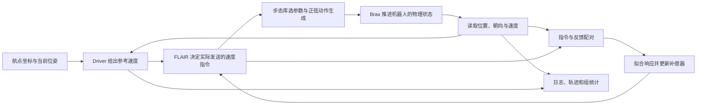

# FLAIR 六足仿真复现代码导读

这套文档以 FLAIR v1.0.0 为准。本地官方源码的提交为 `9e1fa31a8f39b912c5edb61bd65ba15289241276`。先跟踪一条指令，再跟踪一条训练样本，最后跟踪一个回合的成绩。文档里的教学数字用于说明计算，实验数字均来自归档结果。

| 顺序 | 文档 | 学完能解释什么 |
| --- | --- | --- |
| 1 | [从路径点到机器人运动](01_path_to_motion.md) | 航点怎样变成速度要求，步态库怎样生成 18 个动作，Brax 怎样给回车体运动 |
| 2 | [从反馈到下一次补偿](02_feedback_and_adaptation.md) | 为何要配对，模型学什么，状态分量怎样影响计算，哪个函数真正发令 |
| 3 | [从日志到论文结果](03_reproduction_and_metrics.md) | 如何运行原版，80 回合怎么得到，三套误差怎样算，138.8% 与 13.0% 各说明什么 |

第一次读源码，可以同时打开 [flair_example.py](../../03_code/references/FLAIR/fast_adaptation/example/flair_example.py:1463) 和[逐行日志示例](03_reproduction_and_metrics.md#4-把真实日志的头三行对回源码)。从主程序的 `while not driver_done` 往下看，遇到 `driver.follow_path`、`flair.get_command` 和 `env_manager.step` 时才跳到对应定义。先记住每段收什么、返回什么，再看该段内部。

| 材料 | 用途 |
| --- | --- |
| [官方 v1.0.0 源码](https://github.com/adaptive-intelligent-robotics/FLAIR/tree/v1.0.0) | 核对发布版实现 |
| [作者数据与六足 notebook](https://zenodo.org/records/14546657) | 对齐论文的误差计算及四组统计 |
| [复现记录](../../05_experiments/flair/reproduction.CN.md) | 查询服务端环境、批次记录和项目脚本 |
| [组间指标 CSV](../../05_experiments/flair/results/data/comparison_metrics.csv) | 核对作者与独立批次每组的结果 |
| [论文](https://doi.org/10.1038/s41467-026-70256-y) · [补充材料](https://static-content.springer.com/esm/art%3A10.1038%2Fs41467-026-70256-y/MediaObjects/41467_2026_70256_MOESM1_ESM.pdf) | 查原论文实机及六足评测的范围 |

早期选题已归档。当前研究仍可重新选择论文与方向，见[STATUS](../../STATUS.CN.md)。六足执行步骤与结果统一见[复现记录](../../05_experiments/flair/reproduction.CN.md)。
