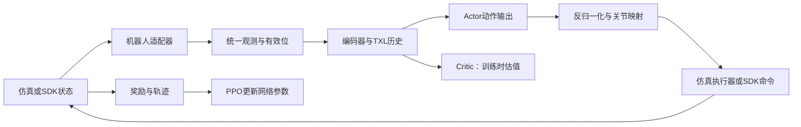

# 统一输入、历史策略、训练与输出：完整实现说明

本篇沿状态读取、统一观测、历史策略、强化学习更新和动作执行的顺序解释实现。论文已公开的方法与本项目拟采用的工程设计分别说明，参考项目用于明确各环节的实现依据。

## 1. 整体链路与四类职责



机器人模型规定身体结构；接口规范规定每个数字的含义；策略学习从输入到动作的关系；适配器把统一动作转换为目标机器人协议。URDF、机器人名字和SDK编号不会自动被神经网络理解。

训练时环境和策略循环交互，获得奖励后用PPO更新参数。部署时权重固定，当前观测和缓存历史不断变化，输出因此变化。上下文适应不等于部署时执行梯度更新。

## 2. 三种统一接口及本项目选择

### 2.1 比较的对象和范围

首先区分三件事：状态数组宽度、实际关节数量、网络内部特征宽度。12关节机器人仅位置与速度就可包含24个数，不能把“32维状态”理解为32个关节；两种输入都变成512维特征，也不代表每一维已经具有相同物理含义。

| 路线 | 输入怎样统一 | 输出怎样对应关节 | 新身体接入要求 | 本项目定位 |
|---|---|---|---|---|
| 固定语义槽位 | 预先规定位置含义，缺失位占位并标记 | 固定动作槽位，由逐机映射解码 | 身体落在已定义集合内；否则扩展槽位与输入层 | 首版主方案 |
| 逐关节表示，参考URMA | 每关节采用相同状态/描述格式，数量可变 | 整体控制特征结合关节描述，逐关节共享解码 | 提供合规结构描述、状态和执行器配置 | 身体差异扩大后的架构对照 |
| 多编码器，本地locoformer示例 | 不同原始输入经各自编码器变为同宽特征 | 调用者选择预定义动作组，再由适配器执行 | 已有合适编码器与动作组，或新增并训练 | 参考核心模块，不作为主接口 |


三种路线是便于工程选型的概括，不是互不兼容的完整算法分类。逐关节批处理也可能使用padding和mask；固定槽位也可以额外加入形态描述。它们的区别在于通过什么信息保持跨身体的含义，以及共享计算发生在哪里。

### 2.2 固定槽位：先统一物理语义

同一位置始终代表同一种关节作用。适配器先重排与缩放状态，再送入共同编码器。输出采用相同语义槽位，每个身体仅执行存在的通道。

```text
普通四足：12个腿状态 + 4个轮占位 ┐
                                ├→ 共同编码器 → 共享策略 → 16路动作
Go2-W：  12个腿状态 + 4个轮状态 ┘
                                    普通四足取12路，Go2-W取16路
```

MetaMorph提供模块/肢体表示、形态条件与掩码处理参考，其实现不等于本项目的平面73维数组。GenLoco用于参考关节方向、默认姿态和控制配置。固定槽位表、有效位及轮速定义由本项目形成明确规范。

### 2.3 逐关节表示：统一记录格式与处理权重

每个关节形成一条状态与结构描述记录，例如局部状态、轴向、位置或连接信息，具体字段依所用实现确定。12关节和16关节分别形成12条与16条有效记录。

本地URMA策略将描述与状态编码后沿关节维汇总，与足部及机体信息组成整体特征，再把整体控制特征与各关节描述、局部状态组合，经共享解码器给出该关节动作。

```text
所有关节记录 → 共享编码与汇总 → 整体控制特征
                                  + 关节i的描述和状态 → 共享解码 → 动作i
```

相同权重处理不同关节输入，因此能产生不同动作；不是为每个关节另建一套网络，也不是各关节互不交流。输出保留与输入记录的对应关系，再由机器人配置映射到执行器。

它更自然支持数量变化，但仍需提供可靠描述、控制类型和设备映射。接入轮足需要检查连续轮关节与速度动作，不能直接假定现有URMA权重适用。若与TXL组合，需同时设计汇总特征的时间记忆和逐关节动作解码，保留局部描述支路。

### 2.4 多编码器：先统一内部特征宽度

本地locoformer README预设`dim_state=[32,16]`，分别建立编码器A与B，随后共享TXL。调用者传`state_id=0/1`，不是网络自动识别机器人类别。

```text
32维状态 → 编码器A → 512维特征 ┐
                               ├→ 共享TXL → 选择当前动作组
16维状态 → 编码器B → 512维特征 ┘
```

输出示例注册18个连续通道，`selectors=[0..11,12..17]`：第0组为12路，第1组为6路。调用时在前向及动作采样中传入`selector_index`，按所选通道生成实际动作。18指动作通道数，动作头还需输出分布参数，不是所有情况下仅输出18个标量。

选择器决定当前使用哪组输出，设备适配器仍需说明每一路对应哪个关节、方向和单位。32/16输入示例是软件示例，不是普通四足/Go2-W的实际观测配置。不同输入宽度被编码为同宽特征，不保证新机器人自动具有匹配的编码器与控制语义。

### 2.5 选择结论与调整条件

首版选固定语义槽位，先覆盖普通12关节四足与16通道Go2-W。候选普通四足为Go2，具体资产先完成阶段1检查；这是接口原型，不代表已经覆盖论文所有身体类型。

选择依据是：腿部对应关系明确，轮通道可以独立表达；便于逐通道验证；可以在不同时引入多种结构变化的情况下研究历史适应。多编码器作为核心代码参考；URMA式表示作为后续对照。

扩大正式训练前，先审查所有目标身体。若关节语义能合理覆盖，定义并冻结更完整超集；若双足、六足或躯干关节使槽位映射过于牵强，再开展逐关节架构对照。切换方案不只替换输入层，还涉及动作解码、概率计算、checkpoint和部署，需独立实验。

### 2.6 第一版原型：16个槽位、73维观测、16路动作

以下均为本项目候选设计，非论文原始配置。

| 槽位 | 含义 | 普通四足 | Go2-W |
|---|---|---|---|
| 0–2 | 右前hip、thigh、calf | 有效 | 有效 |
| 3–5 | 左前hip、thigh、calf | 有效 | 有效 |
| 6–8 | 右后hip、thigh、calf | 有效 | 有效 |
| 9–11 | 左后hip、thigh、calf | 有效 | 有效 |
| 12–15 | 右前、左前、右后、左后轮 | 无效 | 有效 |

这是语义顺序。其他仿真的导入顺序必须按关节名转换，不能因为Go2-W SDK编号恰好相同就省去映射。

采用零起始、左闭右开的数组范围：

| 数组范围 | 字段 | 宽度 |
|---|---|---:|
| `[0:3]` | 机体角速度 | 3 |
| `[3:6]` | 投影重力 | 3 |
| `[6:9]` | 前向、横向、偏航速度指令 | 3 |
| `[9:25]` | 统一槽位相对位置 | 16 |
| `[25:41]` | 统一槽位速度 | 16 |
| `[41:57]` | 上一步动作 | 16 |
| `[57:73]` | 关节有效位 | 16 |

普通四足的四个轮位置、速度和上一动作填零，有效位为0。Go2-W轮位置按候选任务约定置零，轮速和上一动作正常填入，有效位为1。所有无效字段先由输入适配器规范为占位值，不能把任意无效数值直接送给网络。

普通四足与Go2-W分别使用有效位`[1×12,0×4]`和`[1×16]`。有效位表达关节存在性，不包含全部几何和动力学；两台关节集合相同的机器人仍可能质量、腿长和响应不同，后续需要训练分布与历史交互支持适应。

### 2.7 从动作分布到腿与轮命令

统一Actor产生16路动作分布，训练时按配置采样，评估时明确采用采样或确定性输出。普通四足取0–11路，Go2-W取全部16路。方向、默认姿态与scale由逐机器人配置提供。

```text
统一动作a[0:12] → q_target = q_default + sign × scale × a
统一动作a[12:16] → dq_target = sign × wheel_scale × a
```

教学例：某腿关节默认0.6rad，scale为0.25rad，动作0.2，则目标0.65rad；某轮scale为5rad/s、动作0.3，则轮速目标1.5rad/s。数值用于解释解码，不构成实机执行参数。

普通四足的无效轮通道同时从执行、log-prob、熵及相关正则项中按设计排除。对独立逐维动作分布，可按有效位汇总各维log-prob；其他分布需依据其联合概率定义处理。执行mask与注意力mask、序列padding mask职责不同，不共用一个标记代替全部规则。

### 2.8 验证顺序与阶段交付

1. **配置检查**：确认无重复槽位、模型joint和SDK编号，记录轴向、单位、默认值、动作类型及版本。
2. **数据检查**：逐关节填唯一数值，检查重排、符号与缩放；轮位置置零和缺失轮分别测试。
3. **动作检查**：单槽位输入，检查命令写到正确通道，并以手算目标核对解码；机械响应考虑耦合和接触。
4. **缺失位检查**：规范无效输入、屏蔽执行和训练项；相同有效输入下任意外部无效值被规范后不改变网络输入。
5. **原接口往返**：保留57维原基线网络，通过适配器往返检查可复原的物理量。语义上主动丢弃的轮绝对角不要求恢复。
6. **重新训练统一策略**：73维输入层需要新建或明确适配，不能原形状加载57维权重。先Go2-W，再加入普通四足，记录两者指标和干扰。
7. **接口冻结后接TXL**：区分关节维与时间维，之后再增加记忆与跨Trial训练。

计划新增机器人配置、观测编码、动作解码、有效位损失处理和接口检查模块。函数职责可分别为`encode_observation`、`decode_action`和`valid_action_log_prob`；这些是规划名称，当前没有声明已实现。

新增身体首先回答四个问题：槽位能否表达、描述/单位是否一致、动作类型是否支持、模型是否经过检查。新增传感器、关节或观测字段都视为接口版本变更，checkpoint必须保存版本并在加载时检查。

### 2.9 尚需在实验中回答的问题

| 问题 | 当前设计与验证要求 |
|---|---|
| 网络是否需要机器人名称 | 适配器必须知道设备配置；策略首版不依赖类别标签，以状态、有效位和历史为输入。其适应性需实验验证 |
| 两台机器人有效位相同，如何区分动力学 | 有效位不能区分质量、摩擦或延迟；依靠训练分布和动作后的响应历史，不保证单帧可唯一识别 |
| 是否完全不需要本体先验 | 本项目假设能提供关节语义和设备映射；不能据此宣称无需任何本体知识 |
| 多身体怎样训练 | 每个并行环境有自己的身体、状态与缓存，输入统一后共同优化同一组参数；记录身体采样比例，避免简单身体主导平均成绩 |
| 关节维与历史维是否一样 | 关节维组织同一时刻的身体信息，时间维组织交互历史；URMA的身体聚合不自动提供TXL的长时间记忆 |
| 共享训练后某身体退化怎么办 | 逐身体比较单体与共享基线，检查奖励尺度、采样比例、动作语义和任务难度，再判断是否属于负迁移 |
| 怎样算接入新身体成功 | 不只检查能否加载模型；固定权重，使用预先定义映射评估控制表现，报告是否使用额外Trial适应 |
| 怎样判断是否更换接口 | 固定超集不能合理表达目标拓扑时开展独立架构对照；不因一次训练失败就切换所有组件 |

## 3. “缺少关节补零”为什么不是完整答案

| 场景 | q输入 | 有效位 | 含义 |
|---|---:|---:|---|
| 有关节，当前在默认姿态 | 0 | 1 | 真实存在，当前相对位置为0 |
| 身体没有这个关节 | 0 | 0 | 占位，不执行动作 |
| Robot Lab中的轮位置项 | 0 | 1 | 轮存在，但当前任务有意不使用绝对轮角 |

第三种情况尤其重要。Robot Lab的 `joint_pos_rel_without_wheel` 保留向量宽度，把轮位置项置零；轮速度、上一动作和轮执行通道仍存在。这不能解释为“轮电机不存在”。

mask也不自动告诉网络全部动力学。它只能表达预先定义的信息，质量、摩擦、电机延迟等仍需训练分布和交互历史帮助适应。显式mask属于项目设计，需记录与论文描述的差异并做消融。

## 4. 网络怎么知道当前是哪一种身体

适配器知道当前机器人的配置，因此知道关节映射。策略不一定需要一个机器人类别标签；它可以依据统一状态、有效位和动作之后的身体响应历史形成内部表示。知道协议映射与学习动力学是两件事。

例如输出同样的腿目标后，一种身体明显抬升，另一种身体响应缓慢，历史中反映的响应不同，模型可以输出不同后续动作。适应能力由训练分布和运行历史支持，需要通过相同任务与预算下的对照验证。

## 5. Go2-W单时刻观测

Robot Lab参考任务的基础Actor字段顺序为：

| 字段 | 宽度 | 物理或软件来源 |
|---|---:|---|
| 机体角速度 | 3 | IMU或仿真状态 |
| 投影重力 | 3 | 姿态变换 |
| 速度指令 | 3 | 软件给定vx、vy、yaw速率 |
| 相对关节位置 | 16 | q减默认角度，轮位置项置零 |
| 关节速度 | 16 | 反馈dq，相对默认速度按任务处理 |
| 上一动作 | 16 | 策略/动作管理器的软件记录 |
| 合计 | 57 | 仅指这组基础单帧字段 |

本次核查的Go2-W配置移除了Actor真值线速度和高度扫描。实际维数仍须从启动后的环境导出，不能忽略wrapper、历史堆叠、额外命令或normalizer。跨本体版本加入更大槽位与mask后也不再是57。

`B×57`表示B个环境各有一帧；训练序列可能为`T×B×57`，而Transformer常用`B×T×D`。轴序变换是改变排列方式，不是更改物理含义。Actor与Critic输入可能不同，不能直接把Actor数组传给需要特权状态的Critic。

## 6. 单位、方向与归一化

把每个关节的默认姿态记为q0、方向符号记为s、尺度记为d，一种可选表达是：

\[
\bar q=s(q-q_0)/d.
\]

它表示相对默认姿态、统一方向和尺度，不表示所有关节有同一个真实角度范围。轮的绝对角可持续累积，不能直接按有限腿角范围归一化；首版保留参考任务的轮位置置零方式，保留轮速。

坐标系也要固定：机身速度、角速度、重力方向应处于约定坐标中。训练用机体坐标，部署却直接输入世界坐标，会造成同样维数但不同意义的错误。

归一化统计随checkpoint保存，部署使用训练时统计；重新估计统计属于观测处理变更，需要单独记录与评估。

## 7. 中间网络做什么

编码器把统一观测变成内部特征；TXL根据当前特征和历史计算新的表示；Actor产生动作分布参数或确定性均值；Critic在训练时估计后续回报。

本项目先用Robot Lab现成MLP完成基线，再在同一PPO管线中接TXL。目标模型的层数、宽度、segment长度和记忆长度要写入配置，不把本地Microduck默认值当论文设置。首版可先用相同可部署观测连接Actor/Critic，之后若保留特权Critic，要明确独立输入、编码与缓存处理。

连续策略的输出可能是均值和标准差，而不是直接电机命令。训练时按分布抽样以探索，评估通常使用均值；动作分布种类、裁剪和缩放必须固定。本地第三方实现还提供Beta分布和HLGauss价值建模等扩展，不应将通用教学中的高斯Actor/MSE Critic直接说成其唯一实际实现。

## 8. Trial、Episode、segment、rollout分别是什么

| 名称 | 职责 | 是否自然等长 |
|---|---|---|
| 任务 | 同一身体及固定的动力学条件 | 不按segment划分 |
| Trial | 一次身体尝试，可能因跌倒结束 | 通常变长 |
| 外层Episode/任务组 | 同任务若干Trial组成的适应经历 | 按协议定义 |
| segment | Transformer序列计算分块 | 大多固定长度，尾段可短 |
| rollout | 一轮PPO采集的数据范围 | 由采集配置决定 |
| minibatch | 一次优化所用的数据子集 | 由训练器决定 |

同一Trial可以跨多个segment，一个segment也可能跨Trial边界。不能因为segment满了就复位机器人，也不能因为机器人倒了就一定清空所有历史。

## 9. 缓存、KV与SG

原始TXL在段间缓存隐藏表示，后续层从这些表示生成K/V。某些加速实现直接缓存投影后的K/V。两者都传递历史，但缓存格式、所含层数和参数更新后的处理不相同。

SG或detach保留数值，让当前计算继续使用历史，只截断向旧计算链的反向传播。它不会冻结当前网络所有参数。当前段的损失仍更新参与当前计算的权重。

采集时必须逐步等环境响应，不能一次凭空得到未来观测；训练时轨迹已经保存，可以把一段观测并行送入因果注意力计算。因果mask保证位置t不能看t+1的观测。

segment不满可以用真实长度计算或padding加有效位。空位不参与注意力、损失、归一化统计或终止处理。缓存只保留预算允许的近期信息，较早影响可能已压缩到隐藏表示中，不代表逐字完整记住全部历史。

## 10. 三种重置标志必须分开

1. **物理Trial复位**：机器人跌倒后重设姿态，任务仍是同一身体和动力学。
2. **历史重置**：切到新的任务或需要新实验初始条件时清空缓存。
3. **回报/GAE边界**：决定哪些奖励属于同一训练目标、是否bootstrap。

不能把一个`done`同时当作三者。Baby的空`reset()`只能说明该函数没有按done清空，不能证明全任务生命周期正确；本地locoformer的episode-id mask也只有在调用方传对外层任务标识时才符合跨Trial设定。

同任务跨Trial保留历史时，质量、摩擦、关节锁定等任务条件原则上应保持一致；若默认reset事件每次随机化动力学，就会在不标记的情况下改变任务。应拆成任务采样事件和Trial姿态复位事件。

## 11. 一轮PPO的完整时间链

1. 固定旧参数，采集多个环境的观测、动作、奖励、旧log概率和旧价值。
2. 保存任务标识、Trial边界、终止/超时原因和有效位。
3. 根据回报协议计算优势和价值目标，固定它们作为这一轮训练数据。
4. 当前网络重新读取保存的观测与历史，计算同一个旧动作的新log概率，同时建立求梯度所需计算图。
5. 计算PPO Actor、Critic和熵项，在有效位置求平均。
6. 反向传播并由优化器更新参数；同一rollout可以优化多个epoch。
7. 采集下一批新数据，旧策略概率随新一轮采集重新记录。

概率比为 `rho=exp(logp_new-logp_old)`。第一轮更新前ratio可以等于1，但梯度并不为0。Actor损失对有效样本平均：

\[
L_\pi=-\frac1N\sum_t\min\left(\rho_t\hat A_t,\operatorname{clip}(\rho_t,1-\epsilon,1+\epsilon)\hat A_t\right).
\]

取较小值形成保守收益目标：好动作概率提高过多时，裁剪分支限制继续增益；坏动作概率降低过多时，也不让这个方向无限获益。负优势时的行为必须连同min和负号一起理解。

常见价值目标由TD/GAE计算：`delta=r+gamma*bootstrap*V_next-V`，`A=delta+gamma*lambda*continue*A_next`，`Rhat=A+V_old`。bootstrap和continue由协议决定，不必都等于`1-done`。Critic拟合固定Rhat，Actor使用固定A，梯度主要通过本轮新log概率和新价值传播。

### 11.1 多个segment的损失怎样合并

每段计算有效位置的损失和与有效步数。全局平均是“总损失和/总有效步数”，不是不加权平均每段均值，否则短尾段会被过度加权。PPO更新的数据量由rollout及环境数决定，segment只决定怎样分块计算。

首个正确性版本建议按完整环境序列分组，依次处理segment、在段间detach历史，累计各段加权梯度，再对这一序列组更新。每个新的优化epoch重新构造所需历史，避免把上一参数版本的KV直接当作精确的当前网络状态。后续再引入burn-in、环境维minibatch和吞吐优化，并记录近似。

### 11.2 跨Trial的奖励怎么算

先复用单Trial基线。扩展后明确外层任务组目标：如果希望回报包含后续Trial，就把Trial复位作为外层交互中的一个已定义转移，下一状态是复位后的状态，外层结束才停止未来回报。若仍在每个Trial处截断GAE，它是另一种信用分配方案，必须标注，不能只保留缓存就宣称完整复现原目标。

跌倒惩罚、超时bootstrap、复位是否消耗一步、折扣是否跨Trial连续，都需固定。论文公开材料不足以逐行还原其所有实现，本项目应给出自己一致的定义并做对照。

## 12. 输出怎样找到实际电机

映射由适配器完成：统一槽位 → 机器人joint → SDK索引。不存在的槽位不执行。网络不负责猜测设备协议。

腿目标常采用 `q_des=q_default+s*scale*a`，表示相对默认姿态的偏移，**不是每次累加到当前角度**。轮速采用约定的速度尺度和方向。Robot Lab参考配置髋scale=0.125、其他腿关节0.25、轮速5.0，这只是任务配置，不是安全边界。

输出经过有限值检查、动作映射、按类型缩放、范围/变化率限制，再形成SDK命令。若添加滤波，其状态会影响系统动力学；应在仿真中包含同样处理，不能只在实机额外加复杂滤波而不记录。

上一动作字段也要定义为网络原动作还是实际执行动作。参考任务的last_action与其动作管理器一致；修改动作处理后要保持训练与部署语义一致，并同时记录原始、处理后和实际发送动作。

## 13. checkpoint如何使用与复现范围

checkpoint至少保存网络结构配置、权重、观测字段顺序、归一化统计、动作类型/尺度、关节映射版本和历史配置；续训还需要优化器及训练状态。加载成功只证明参数形状能装入，不证明新身体、控制语义或缓存规则匹配。

已核对的作者公开入口尚未提供完整训练工程和checkpoint。GenBot专家、URMA学生和Robot Lab基线分别服务各自的训练方法；采用其权重时记录原始任务与适用范围，LocoFormer机制仍需单独训练和评估。

## 14. 实现前的检查清单

- 同一冻结权重下，逐步推理和分段因果推理在相同历史条件下是否一致？
- 改变未来输入是否不影响过去输出？
- 切换一个并行环境的任务，是否只清空该环境历史？
- 轮位置置零是否仍保留轮速度与轮动作？
- 缺失关节是否既不执行，也不计入无意义的动作熵/概率损失？
- 参数更新后，旧KV采用重建、burn-in还是近似复用？
- GAE的物理终止、超时和外层任务结束是否分别处理？
- 部署使用的观测、归一化、滤波和上一步动作定义是否与训练一致？

源码依据及项目差异见[参考项目审查](references.CN.md)，逐阶段执行安排见[工作计划](workplan.CN.md)。

## 主要依据

- [LocoFormer项目页](https://generalist-locomotion.github.io/)与[论文](https://openreview.net/forum?id=VqmAvBkFhw)：方法、训练组织和实验目标。
- [Transformer-XL原论文](https://arxiv.org/abs/1901.02860)：段间递归与停止梯度。
- [PPO原论文](https://arxiv.org/abs/1707.06347)、[GAE原论文](https://arxiv.org/abs/1506.02438)：代理目标、优势估计与多轮更新。
- [Robot Lab v2.3.2](https://github.com/fan-ziqi/robot_lab/tree/v2.3.2)：Go2-W参考任务的观测、动作和训练配置。
- 各第三方实现的固定提交和审查范围见参考项目文档。统一槽位、显式有效位及重置规范中的新增设计均需在实施时独立验证。
