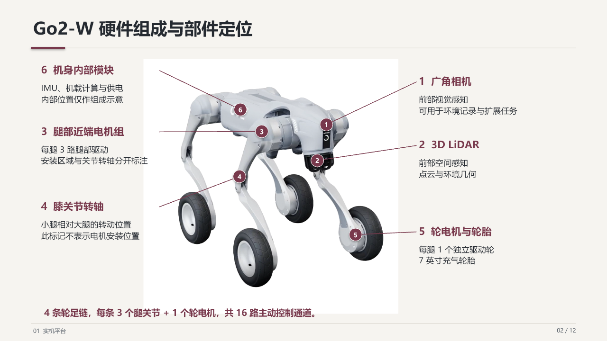

# Go2-W硬件与SDK接口

## 1. 平台定位与控制要求

Go2-W是四轮足机器人。每条腿包含外展/内收、大腿俯仰、膝部屈伸三个腿部自由度，并在末端配置独立驱动轮，全机共16路主动控制通道。复现工作的硬件适配重点是：从机体和关节反馈构造观测，再将策略输出转换为12路腿部位置目标与4路车轮速度目标。

IMU和电机状态是首版策略的主要实机输入。相机、LiDAR用于环境记录和后续感知扩展，首版不把图像或点云加入策略。机载计算平台承担部署推理，服务器承担仿真训练。



图中腿部电机组标注安装区域，膝部标注关节转轴，轮端驱动单列。近端电机布局依据现场提供的说明；外观图与URDF均不足以确定内部传动结构。机身内部模块为组成示意。[产品图来源](https://uploads.unchainedrobotics.de/media/products/Go2_W_PB5_456b21c6.png)。

### 1.1 机械结构与驱动的对应关系

| 部分 | 每腿数量 | 运动作用 | 全机数量 | 对应控制量 |
|---|---:|---|---:|---|
| hip关节 | 1 | 腿相对机身外展、内收 | 4 | 腿部位置目标 |
| thigh关节 | 1 | 大腿前后俯仰 | 4 | 腿部位置目标 |
| calf关节 | 1 | 膝部屈伸 | 4 | 腿部位置目标 |
| wheel关节 | 1 | 车轮连续转动 | 4 | 车轮速度目标 |

关节表示机械构件之间的运动关系，电机提供驱动力，两者通过传动连接。关节转轴的位置不能直接作为电机安装位置。腿部驱动按近端电机组说明，膝部仍是独立受控自由度；轮端电机独立驱动车轮。


官方URDF定义12个revolute关节和4个continuous关节。模型中的固定安装连接不增加可控自由度；浮动机身的空间运动也不是额外六路电机。hip的模型轴为局部X，其他三类为局部Y，正方向最终按模型坐标和实机反馈核对。

### 1.2 16路关节驱动、候选槽位与SDK通道

每行对应一个独立驱动通道，关节名称取自模型命名。槽位是本项目四足/轮足原型的候选定义，SDK编号来自官方Go2-W常量表；两者在此版本中采用相同数值，但属于不同层次。其他模型的导入顺序仍需按名称映射。

| 模型关节/驱动通道 | 运动作用 | 候选槽位 | SDK编号i | 状态读取 | 命令写入 |
|---|---|---:|---:|---|---|
| FR_hip_joint | 外展/内收 | 0 | 0 | motor_state[0] | motor_cmd[0]：q位置目标 |
| FR_thigh_joint | 大腿俯仰 | 1 | 1 | motor_state[1] | motor_cmd[1]：q位置目标 |
| FR_calf_joint | 膝部屈伸 | 2 | 2 | motor_state[2] | motor_cmd[2]：q位置目标 |
| FR_foot_joint | 车轮连续转动 | 12 | 12 | motor_state[12] | motor_cmd[12]：dq速度目标，kp=0 |
| FL_hip_joint | 外展/内收 | 3 | 3 | motor_state[3] | motor_cmd[3]：q位置目标 |
| FL_thigh_joint | 大腿俯仰 | 4 | 4 | motor_state[4] | motor_cmd[4]：q位置目标 |
| FL_calf_joint | 膝部屈伸 | 5 | 5 | motor_state[5] | motor_cmd[5]：q位置目标 |
| FL_foot_joint | 车轮连续转动 | 13 | 13 | motor_state[13] | motor_cmd[13]：dq速度目标，kp=0 |
| RR_hip_joint | 外展/内收 | 6 | 6 | motor_state[6] | motor_cmd[6]：q位置目标 |
| RR_thigh_joint | 大腿俯仰 | 7 | 7 | motor_state[7] | motor_cmd[7]：q位置目标 |
| RR_calf_joint | 膝部屈伸 | 8 | 8 | motor_state[8] | motor_cmd[8]：q位置目标 |
| RR_foot_joint | 车轮连续转动 | 14 | 14 | motor_state[14] | motor_cmd[14]：dq速度目标，kp=0 |
| RL_hip_joint | 外展/内收 | 9 | 9 | motor_state[9] | motor_cmd[9]：q位置目标 |
| RL_thigh_joint | 大腿俯仰 | 10 | 10 | motor_state[10] | motor_cmd[10]：q位置目标 |
| RL_calf_joint | 膝部屈伸 | 11 | 11 | motor_state[11] | motor_cmd[11]：q位置目标 |
| RL_foot_joint | 车轮连续转动 | 15 | 15 | motor_state[15] | motor_cmd[15]：dq速度目标，kp=0 |

读取路径为`LowState.motor_state[i]`，可获得q、dq、ddq、tau_est、temperature等；写入路径为`LowCmd.motor_cmd[i]`，包含mode、q、dq、tau、kp、kd。消息通过`rt/lowstate`接收、`rt/lowcmd`发送。表中的腿位置与轮速是首版采用的命令方式，不代表驱动消息只有这两种字段。

这些编号表示控制通道，不是厂家电机产品型号或序列号。公开资料没有逐一给出16台电机的实体型号及内部传动参数；最大电机约45N·m不能推广为全部通道。产品能力、URDF限制、仿真执行器和实机约束分别记录。

## 2. 硬件数据从哪里读取

Unitree SDK2提供机器人通信接口，Python版本为`unitree_sdk2_python`，底层使用Cyclone DDS。低层状态采用主题订阅，控制命令采用主题发布；模式与视频等服务使用客户端请求。SDK2提供通信和消息定义，策略网络及其观测处理需要另行实现。

| 硬件或功能 | 读取/调用入口 | 返回内容 | 本项目用途 | 依据 |
|---|---|---|---|---|
| 机身IMU | 订阅`rt/lowstate`，读取`msg.imu_state` | 姿态四元数、角速度、加速度等 | 角速度与投影重力 | SDK消息定义、Go2-W示例 |
| 16路电机反馈 | 同一消息的`msg.motor_state[i]` | q、dq、估计力矩、温度等 | 关节观测、动作跟踪与日志 | Go2-W示例 |
| 腿部控制 | 发布`rt/lowcmd`中的`motor_cmd[0:12]` | q、dq、kp、kd、tau等命令字段 | 12路腿部位置控制 | Go2-W示例 |
| 车轮控制 | 同一命令的`motor_cmd[12:16]` | dq目标及增益等 | 4路车轮速度控制 | Go2-W示例 |
| 控制模式 | `MotionSwitcherClient.CheckMode()`、`ReleaseMode()` | 返回码与模式信息 | 低层控制前核对控制权 | SDK服务接口 |
| 前部相机 | Go2系列`VideoClient.GetImageSample()` | 返回码、编码图像字节 | 图像记录，后续扩展 | 官方Go2相机示例；Go2-W设备服务需验证 |
| LiDAR | 按实际型号选择雷达驱动或已有点云接口 | 点云、设备时间等 | 环境记录与后续感知 | 需匹配设备型号，不能由LowState替代 |

**接口范围：** Go2-W低层示例已经明确状态主题、电机编号和混合控制方式。官方相机示例位于Go2目录，可作为服务接入参考，但本项目尚未在Go2-W上验证。LiDAR型号未由当前资料唯一确定，因此不指定未经验证的驱动或主题。L1的官方`unilidar_sdk`不能直接视为所有雷达型号的通用驱动。

### 2.1 IMU与关节状态的读取过程

初始化DDS通信时选择与机器人连接的网卡，创建`LowState_`订阅器。新消息到达后，SDK调用状态回调，程序在回调中保存最新反馈；策略周期线程再读取一份一致的状态快照，避免边更新边拼接观测。

下面仅展示接口关系，不是完整启动程序：

```python
def on_low_state(msg):
    # 实际工程中应同步保存状态和接收时间。
    quaternion = msg.imu_state.quaternion
    angular_velocity = msg.imu_state.gyroscope
    joint_position = [msg.motor_state[i].q for i in range(16)]
    joint_velocity = [msg.motor_state[i].dq for i in range(16)]

ChannelFactoryInitialize(0, network_interface)
subscriber = ChannelSubscriber("rt/lowstate", LowState_)
subscriber.Init(on_low_state, 10)
```

实际程序还需处理首帧等待、接收时间、状态超时和线程同步。q是关节位置反馈，不能把它理解为电机转子未经减速后的角度。

### 2.2 从反馈构造策略观测

| 观测字段 | 数据来源 | 处理方式 |
|---|---|---|
| 机体角速度 | IMU gyroscope | 坐标与单位核对、按训练配置缩放 |
| 投影重力 | IMU quaternion | 将世界重力方向变换到机体坐标 |
| 速度指令 | 任务或操作输入 | 形成前向、横向、偏航速度指令 |
| 相对关节位置 | motor_state[i].q | 按名称重排，减默认角度，轮位置项按任务置零 |
| 关节速度 | motor_state[i].dq | 按同一映射重排、缩放 |
| 上一步动作 | 策略运行器保存 | 保持与训练时last_action定义一致 |

Robot Lab参考Go2-W任务的基础Actor观测为3+3+3+16+16+16=57个数。该数值属于单体任务配置；后续统一关节空间的宽度由身体集合和接口设计决定，不能直接把57维称为论文的统一输入。

四元数用于姿态变换。若R表示从机体到世界的旋转，机体系重力为`R.T @ g_world`。投影重力是计算结果，不是单独的传感器。加速度不能简单积分后就当作可靠机体速度。

### 2.3 相机与LiDAR的接入范围

官方相机示例创建`VideoClient`，调用`Init()`和`GetImageSample()`，检查返回码后把编码字节交给OpenCV解码。它没有直接返回目标物体类别，也不自动提供标定结果。Go2-W上应验证服务是否开放、图像尺寸和实际帧率。

LiDAR通过对应设备驱动输出点云。点云坐标系、时间戳、外参和接收频率应随设备配置记录。若使用既有ROS点云，应核对其实际发布节点和消息类型。首版运动策略不依赖该链路，雷达接入不会阻塞本体感觉基线。

SDK消息中存在`foot_force`等共用字段，不足以证明Go2-W配置了可用的独立足端力传感器；`tau_est`也是估计力矩。硬件清单、协议字段和有效测量需分别登记。

### 2.4 SDK中可读取、可控制和本阶段使用范围

| 对象 | 已确认的读取/调用能力 | 控制能力或边界 | 本阶段采用 |
|---|---|---|---|
| 腿与轮电机 | LowState.motor_state：q、dq、估计力矩、温度等 | LowCmd.motor_cmd：位置、速度、前馈力矩及增益字段 | 腿位置、轮速度；记录反馈 |
| IMU | LowState.imu_state：姿态、角速度、加速度 | 状态读取；不向IMU发送运动命令 | 构造角速度和投影重力 |
| 电源与遥控输入 | LowState含bms_state、power_v、power_a、wireless_remote | 消息字段不等于通用电源控制；遥控字节需按协议解析 | 记录状态，按协议接入人工控制逻辑 |
| 前部相机 | VideoClient.GetImageSample返回码与编码图像 | 已核对例程提供取帧；不推定额外曝光/云台控制 | Go2系列接口参考，验证Go2-W设备服务后记录 |
| 3D LiDAR | 对应型号驱动获取点云；L1 SDK另支持雷达IMU与参数配置 | 不经LowCmd控制；SDK必须与实际型号和连接方式匹配 | 设备识别与记录，首版策略不依赖点云 |
| 运动与模式服务 | MotionSwitcherClient.CheckMode；SportClient包含Move等服务 | ReleaseMode等管理控制权；高层Move使用厂商运动控制器 | 低层策略与厂商运动控制服务分开，明确交接 |

SDK公开代码证明接口定义存在，设备固件是否开放相机或特定运动服务仍需现场检查。相机和雷达未完成接入时，先推进本体感觉控制；不把其接口验证状态写成已经完成。

## 3. 策略输出怎样作用到电机

### 3.1 SDK电机编号

FR、FL、RR、RL分别为右前、左前、右后、左后，以机器人自身方向为准，索引从0开始。

| 腿 | hip | thigh | calf | wheel |
|---|---:|---:|---:|---:|
| FR | 0 | 1 | 2 | 12 |
| FL | 3 | 4 | 5 | 13 |
| RR | 6 | 7 | 8 | 14 |
| RL | 9 | 10 | 11 | 15 |

SDK数组预留20个电机槽位，当前Go2-W使用16路。模型轮关节可能名为`FR_foot_joint`，映射时应同时检查名称和continuous类型。仿真关节顺序、统一槽位顺序与SDK编号通过配置显式关联。

### 3.2 腿与轮采用不同的动作解码

腿部输出转换为位置目标：`q_des = q_default + action_scale * action`，表示相对默认姿态的偏移。车轮输出转换为轮速目标：`dq_des = wheel_scale * action`。方向符号在映射配置中单独指定。目标不逐步累加到当前角度。

官方Go2-W示例对腿设置q目标和PD增益，对轮设置kp=0并发送dq目标。`MotorCmd_`还包含mode和tau。控制含义可用标准PD形式解释：

\[
\tau_{cmd}=K_p(q_{des}-q)+K_d(\dot q_{des}-\dot q)+\tau_{ff}.
\]

该式说明命令字段之间的关系，不代表已获得驱动器完整内部控制算法。示例增益、Robot Lab执行器增益和实机拟采用参数分别管理。

### 3.3 命令发布与控制权


发布器使用`ChannelPublisher("rt/lowcmd", LowCmd_)`，初始化后通过`Write(cmd)`发送。发送前计算`cmd.crc = CRC().Crc(cmd)`。控制程序必须先取得有效状态，再按照明确的模式管理流程启用命令发送。

`SportClient`用于调用厂商运动服务；`MotionSwitcherClient`用于查询和释放相关控制模式。低层策略直接产生关节目标，厂商高层运动服务与策略不能同时控制同一执行器。官方站立例程包含真实运动及模式切换，不能用作只读检查程序。

### 3.4 两个控制周期

Robot Lab参考任务的物理步长为5 ms，每4步更新策略，即50 Hz。官方Go2-W例程以2 ms间隔刷新命令，目标发送频率为500 Hz。策略更新与命令刷新可以分开：策略计算新目标，发送线程在下一次策略更新前保持最近有效目标。最终频率以推理耗时、通信和反馈测量为准。

## 4. 产品与模型参数

### 4.1 厂商产品规格


以下为 Unitree Go2-W 型号页公开规格，属于厂商产品信息，不是本项目实测。

| 项目 | 公开信息 | 对复现的用途 |
|---|---|---|
| 站立外形 | 70 × 43 × 50 cm | 场景尺寸、初态及净空参考 |
| 含电池重量 | 约 18 kg | 核对模型总质量与负载变化 |
| 载荷 | 约8 kg，最大约12 kg | 负载实验的资料依据，不作为初期测试目标 |
| 标称速度 | 0–2.5 m/s | 逐步设置速度任务范围 |
| 轮胎 | 7英寸充气轮胎 | 轮地接触与有效滚动半径 |
| 越障高度 | ＜70 cm | 厂商能力描述，不能直接设为初期地形难度 |
| 最大爬坡角 | 35° | 地形课程设计的背景信息 |
| 电压 | 33.6 V | 设备供电与日志记录 |
| 电池 | 15 Ah | 功耗、测试时长和设备登记 |
| 标称续航 | 1.5–3 h | 受负载、速度、温度和工况影响 |
| 充电器 | 33.6 V / 9 A | 充电设备规格 |
| 基础计算 | 8核高性能CPU | 推理进程部署与负载测量 |
| 扩展计算 | Orin NX等为选配 | 不能据此断言当前设备已安装 |
| 感知 | 超广角3D LiDAR、高清广角相机 | 空间/图像资源 |
| 通信功能 | Wi-Fi 6、4G、Bluetooth | 不等同低层控制接口的权限与实时性 |
| 操作与维护 | APP、遥控器、前灯、语音、OTA、二次开发 | 固件和模式管理 |

7英寸轮胎直径按英制换算约177.8 mm，未压缩半径约88.9 mm，但这不是标定后的有效滚动半径。轮胎形变和滑移会使实际里程不同。厂商速度上限也不是策略允许发送的轮速上限。


### 4.2 公开模型与仿真执行器参数


| 关节 | 位置范围 rad | 模型 effort N·m | 模型速度 rad/s |
|---|---:|---:|---:|
| hip | −1.0472 ～ 1.0472 | 23.7 | 30.1 |
| 前腿 thigh | −1.5708 ～ 3.4907 | 23.7 | 30.1 |
| 后腿 thigh | −0.5236 ～ 4.5379 | 23.7 | 30.1 |
| calf | −2.7227 ～ −0.83776 | 35.55 | 20.07 |
| wheel | continuous，无有限位置上下界 | 23.7 | 30.1 |

要保留四套不同限制：URDF模型限制、仿真执行器限制、策略动作范围、实机驱动与软件限制。Robot Lab v2.3.2 还给出自己的执行器参数，腿和轮的仿真 effort 为23.5、速度30，腿 stiffness=25、damping=0.5，轮 stiffness=0、damping=0.5。这些与URDF字段不完全相同，不能混成“厂家统一电机参数”。

产品页约45 N·m是最大规格电机的最大扭矩，不是16路电机共同的持续可用力矩。本次URDF各惯性链接质量相加约19.523 kg，也不等于产品页约18 kg；模型与实物需要分别登记，不能直接把模型质量当作称重结果。


### 4.3 传感器安装与设备登记

公开URDF的IMU挂点相对base约(-25.57,0,42.32) mm，radar挂点约(289.45,0,-46.825) mm。这些为模型坐标，不代替实际标定。机身相机和LiDAR的分辨率、量程、型号与内外参应依据该台设备资料及只读检查记录。

设备记录包括型号、固件、SDK提交、计算模块、网卡、传感器型号和时间戳来源；关节记录包括模型名、SDK编号、正方向、默认姿态、单位和命令类型。仿真、输入处理和实机命令共用同一份映射，减少独立维护造成的偏差。

## 5. 硬件与SDK如何落实到工作计划

硬件说明用于确定数据和控制要求，SDK例程用于确定消息与调用。两者在实施中对应以下任务。

| 硬件与接口依据 | 对应阶段 | 本项目需要完成 | 验证方式 |
|---|---|---|---|
| URDF的12个腿关节、4个轮关节；SDK编号0–15 | 1 平台准备 | 建立模型名、槽位、SDK编号和方向映射 | 仿真逐路输入与响应；人工核对映射表 |
| LowState中的IMU与motor_state | 1、6 | 编写只读采集，记录姿态、q、dq和接收时间 | 静止反馈、有限值、维度与周期检查 |
| 四元数、关节默认值、Robot Lab观测定义 | 3、6 | 姿态变换、重排和归一化，复用训练时观测处理 | 固定记录回放，比较仿真定义与实机处理结果 |
| Go2-W示例的腿q目标、轮dq目标 | 3、6 | 分别解码12路位置与4路轮速 | 单槽位样例；闭环时核对命令与对应反馈 |
| LowCmd、CRC和控制模式接口 | 6 | 命令构造、周期发送、控制权与超时管理 | 先影子记录，再受约束闭环与异常退出检查 |
| 相机服务与对应型号雷达驱动 | 设备记录，可并行 | 核对设备型号与服务，保存图像/点云及时间 | 返回码、解码、频率和坐标记录，不阻塞首版基线 |

官方站立例程用于阅读协议和控制方式，其中包含真实运动与模式切换。本项目需独立实现只读入口；训练和部署使用同一份观测及动作映射，避免两套定义逐步偏离。

详细阶段任务见[工作计划](../locoformer/reproduction/workplan.CN.md)，统一接口原理见[核心实现](../locoformer/reproduction/interfaces.CN.md)。

## 来源


- [Go2-W官方产品页](https://www.unitree.com/go2-w/)。
- [Unitree官方URDF](https://github.com/unitreerobotics/unitree_ros/blob/master/robots/go2w_description/urdf/go2w_description.urdf)。
- [Go2-W官方控制示例](https://github.com/unitreerobotics/unitree_sdk2_python/blob/master/example/go2w/low_level/go2w_stand_example.py)。
- [SDK消息定义](https://github.com/unitreerobotics/unitree_sdk2_python/tree/814556d15970dd2ecf1c9984e845ca02ab07e206/unitree_sdk2py/idl/unitree_go/msg/dds_)。
- [Robot Lab v2.3.2资产配置](https://github.com/fan-ziqi/robot_lab/blob/v2.3.2/source/robot_lab/robot_lab/assets/unitree.py)。
- 电机近端布局：用户现场说明；内部传动形式未由本次公开模型独立验证。

- [官方Go2相机示例](https://github.com/unitreerobotics/unitree_sdk2_python/blob/master/example/go2/front_camera/camera_opencv.py)与[VideoClient](https://github.com/unitreerobotics/unitree_sdk2_python/blob/master/unitree_sdk2py/go2/video/video_client.py)。
- [MotionSwitcherClient](https://github.com/unitreerobotics/unitree_sdk2_python/blob/master/unitree_sdk2py/comm/motion_switcher/motion_switcher_client.py)。
- [Unitree L1 LiDAR SDK](https://github.com/unitreerobotics/unilidar_sdk)：仅作对应型号的驱动参考。

- [官方Go2-W电机编号](https://github.com/unitreerobotics/unitree_sdk2_python/blob/master/example/go2w/low_level/unitree_legged_const.py)。
- [SportClient服务定义](https://github.com/unitreerobotics/unitree_sdk2_python/blob/master/unitree_sdk2py/go2/sport/sport_client.py)。
