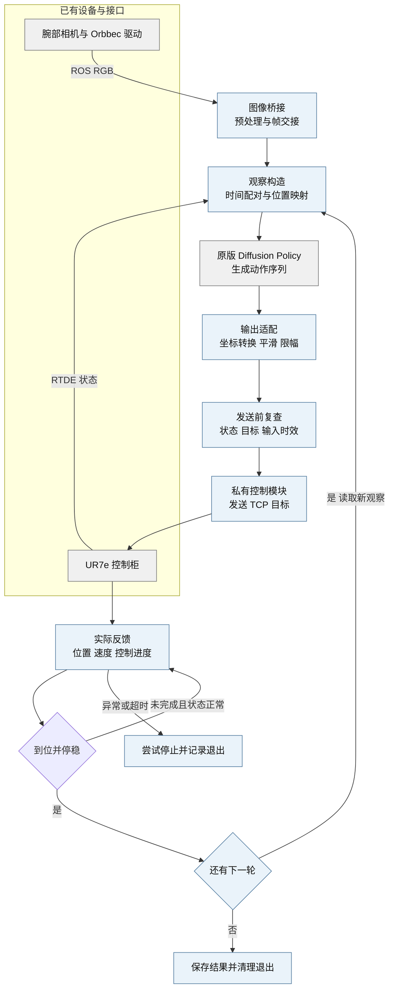
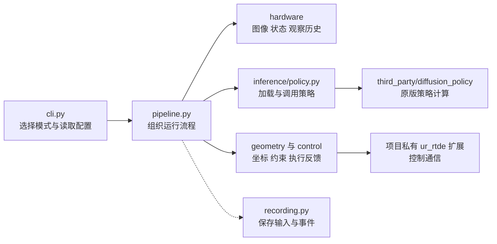

# Diffusion Policy 在 UR7e 平台上的部署进展汇报

## 一 本阶段的目标

本阶段将论文中的 Diffusion Policy 接入现有 UR7e 和单腕部相机，建立从真实观察到机器人执行的完整流程。工作重点是完成硬件与策略之间的接口适配，并通过实际运动反馈验证链路。

目前，原部署版本已经完成一次实机短测：真实图像和机器人状态进入模型，预测结果经过转换与限制后驱动机械臂运动，并保存了相应的输入、指令和反馈记录。

## 二 整体方案与已有基础

平台已有 UR7e、Gemini 335L 腕部相机、ROS 2 和相机驱动。策略部分复用论文官方实现及公开的 Push-T 仿真图像 Transformer 权重。本阶段没有重新训练模型，新增工作集中在观察构造、坐标转换、受限执行和反馈验证。

整体流程如下。灰色表示已有设备或原版策略，蓝色表示本项目接入和编排的环节。



适配层连接了模型与硬件两端：输入端满足原模型的观察要求，输出端将预测转换为当前机械臂可执行、可监测的目标。

## 三 完整流程是怎样打通的

### 1 从硬件取得观察

相机沿用服务器已有的 Orbbec 驱动发布 RGB 图像。由于相机的 ROS 环境与模型的推理环境不同，新增图像桥接程序，完成图片读取、格式整理和尺寸调整，再将处理后的画面交给推理程序。

机械臂状态通过 ur_rtde 直接从控制柜读取，包括末端位姿、关节角和运行状态。当前策略使用末端平面位置，完整位姿与关节信息则用于后续执行检查和记录。末端位置既告诉策略“机器人现在在哪里”，也为执行后的到位判断提供反馈。

两类数据分别持续采集，再依据时间构成最近两次观察，避免将较早的图片与较晚的机器人位置随意组合。这样，硬件输出才能成为一组时间关系一致的策略输入。

### 2 将真实数据整理为模型输入

公开的仿真模型接收图片和二维推动器位置，而实际平台提供腕部画面与米制 TCP 位姿。因此，需要同时处理图片格式与位置定义。

图片经过裁剪、缩放和数值格式转换，满足模型要求；TCP 的 X、Y 则以会话启动位置为参考，映射到模型使用的二维任务坐标。此处完成的是明确、可追溯的工程换算，尚未建立经过标定的相机与真实工作区对应关系。

这一设计将硬件差异集中在输入适配层，使原策略可以按原有接口计算。裁剪是否覆盖完整任务区域、腕部视角是否适合任务，需要在后续任务实验中进一步确认。

当前一次输入包含两张 RGB 图片和两个对应的二维位置，数组形状分别为 image [1,2,3,96,96] 和 agent_pos [1,2,2]。这里的尺寸和排列由所选 checkpoint 决定，适配层负责满足这一输入约定。

### 3 调用原策略生成动作计划

模型加载时核验权重，并保留官方参数和训练时的归一化规则。推理时，图片先经过视觉编码，再与机器人位置共同作为条件；模型从随机动作计划开始，逐步去噪，生成未来的二维动作序列。

因此，相机和位置负责描述当前处境，扩散过程负责生成与观察对应的动作计划。视觉特征在本轮去噪中共享使用，去噪计算本身不会向机械臂发送运动指令。

当前运行保留原 checkpoint 的采样流程。为了先验证实机接口，每轮仅选取可用动作段的第一个目标；待其执行完成后，再读取新观察、重新推理。

代码中，观察转换为模型张量后，推理封装直接调用原策略，核心调用为：

```python

with torch.inference_mode():

    result = policy.predict_action(tensors)

```

原策略负责视觉编码和动作采样；我们编写的封装负责准备输入、加载权重和整理返回结果，使模型计算与硬件操作保持清晰的接口。

### 4 将预测转换为真实运动目标

模型输出仍属于仿真任务坐标，不能直接作为机器人指令。输出适配层先将其换算为真实坐标，再结合推理结束后的实际位置计算位移，依次进行单步限幅、平滑和累计范围检查。

平面目标确定后，补齐参考高度与朝向，形成完整 TCP 位姿，由控制柜协调六个关节完成运动。当前短测保持高度、朝向和夹爪状态，重点验证平面小幅运动。

这层约束实际作用于最终目标。例如，首轮预测换算出的原始目标距离约为 46.4 毫米，经过处理后提交的运动目标约为 0.5 毫米。单步距离、累计路程和执行次数均设置了小范围上限。

从预测到候选目标，主流程中的关键交接是：

```python

raw = output["action"][0, 0]

desired = mapping.to_base(raw)

target = guard.propose(desired, actual_pose, source_age_s=source_age_s)

```

三行分别完成“选择本轮动作、换回真实坐标、生成受限目标”。它们还不发送运动；实际发送及反馈检查由后面的控制模块负责。

### 5 约束控制通信并确认实际到位

仅在 Python 层限制目标，还不能约束通信库内部的异常处理。检查 ur_rtde 后发现，部分控制路径存在自动重连或旧命令重发行为，可能使目标在恢复通信后才被执行，与输入时效要求不一致。

因此，在保留普通安装库的基础上，复制并修改控制源码，取消自动重连和旧运动命令重发，约束发送及确认等待，并明确记录未确认的停止操作。修改后的代码在服务器独立编译为 Python 可加载的项目专用模块，状态读取仍使用原接收接口。外层动作约束负责决定“允许提交多大的目标”，修改后的控制库负责约束“目标在通信异常时如何处理”，两者分别作用于目标计算和指令传输。

发送前重新检查机器人状态、工具 TCP、目标可达性和观察时效。发送后持续读取实际位姿、速度和控制进度，只有运动结束、位置接近目标且已经停稳，才确认本次完成。由此将“生成预测”“指令被接收”和“机械臂实际到位”三个阶段连接起来。

## 四 系统怎样运行与验证

日常运行分为三个进程：

| 进程 | 职责 |

|---|---|

| 相机驱动 | 取得并发布指定腕部相机画面，启动或复用已有进程 |

| 图像桥接 | 在 ROS 环境处理图片，交给独立推理环境 |

| 主程序 | 自动连接 RTDE、构造观察、加载策略，并执行所选运行流程 |

模型加载、状态接收、推理、目标处理和反馈检查由主程序内部调用，无需逐个启动代码文件。首次正式执行前进行一次推理预热并丢弃结果，再使用新观察生成目标，减少启动开销对正式动作的影响。

验证采用分阶段推进：先确认真实观察有效，再验证只推理输出，然后检查受限目标，最后开展短距离实机执行。这样可以分别定位采集、模型、坐标转换和控制问题。

工程按采集、推理和控制三个模块组织，保留原论文代码及权重来源；每次运行记录实际输入、原始预测、最终目标和运动反馈，便于复查和后续实验复现。

主程序的执行顺序为：加载模型与启动采集 → 等待有效观察并预热 → 建立执行基线 → 获取新观察并推理 → 处理目标、执行和确认 → 进入下一轮或清理退出。当前短测至多提交三条目标。

### 代码组织与模块交接

下图展示重构版的主要调用关系，实机结果仍对应保留的原部署版本。主流程负责组织步骤，硬件、推理和控制模块分别实现各自接口。



主要业务结构如下：

```text

diffusion_policy_ur7e_refactored/

├── src/dp_ur7e/

│   ├── cli.py / config.py         运行入口与配置

│   ├── pipeline.py                采集到执行的主流程

│   ├── hardware/

│   │   ├── camera_bridge.py       ROS 图像桥接

│   │   ├── camera.py              图片处理与帧文件

│   │   ├── robot_state.py         RTDE 状态读取

│   │   └── observations.py        双帧观察与时间配对

│   ├── inference/policy.py        原策略加载与推理封装

│   ├── geometry.py               真实坐标与模型坐标转换

│   ├── control/

│   │   ├── safety.py              动作限幅和平滑

│   │   └── robot.py               发送、反馈与控制库核验

│   └── recording.py              运行证据保存

├── third_party/

│   ├── diffusion_policy/          固定版本论文源码

│   └── ur_rtde_guarded/           修改后的控制源码与补丁

├── models/                        checkpoint 与来源清单

├── scripts/                       环境、下载、编译和验证工具

└── runs/                          每次运行的输入与反馈记录

```

原论文模型和第三方依赖保留来源，新增适配集中在 src/dp_ur7e。这样的组织使硬件调整、模型更换和执行行为修改各有明确位置，也便于对照原版与适配代码。

## 五 实机验证结果

2026 年 10 月 25 日，原部署版本完成一次包含三条目标的短测：

| 目标 | 提交目标距离 | 实际起止位移 |

|---|---:|---:|

| 1 | 0.5004 毫米 | 0.4950 毫米 |

| 2 | 0.7740 毫米 | 0.7510 毫米 |

| 3 | 0.8446 毫米 | 0.8314 毫米 |

三条运动均有命令确认和到位记录，共保存 132 条运动反馈，首条运动前到末条运动后的净位移约为 2.02 毫米。

这组记录支持的结论是：真实相机与机器人状态已经能够经过原策略和适配层，形成受限目标并由实体执行。结果来自一次链路短测，尚未评价真实 Push-T 任务成功率。

## 六 当前进展与后续工作

本阶段完成了观察输入适配、原策略调用、动作输出适配、控制通信修改与反馈验证，形成了可继续开展实验的平台基础。

原部署版本保留实机记录；复制重构后的版本完成了离线检查，仍需在目标服务器重新验收。下一阶段先确认重构版本的运行一致性，再确定任务视野、坐标和动作定义，采集真实演示，并训练或微调适合单腕部相机的策略。

---

参考：[论文官方代码与实机教程](https://github.com/real-stanford/diffusion_policy) · [当前官方仿真权重](https://diffusion-policy.cs.columbia.edu/data/experiments/image/pusht/diffusion_policy_transformer/train_0/checkpoints/epoch=0100-test_mean_score=0.748.ckpt) · [原部署实机记录](../../../99_archive/code.zip) · [重构版主流程](../../../03_code/diffusion_policy_ur7e/src/dp_ur7e/pipeline.py)

