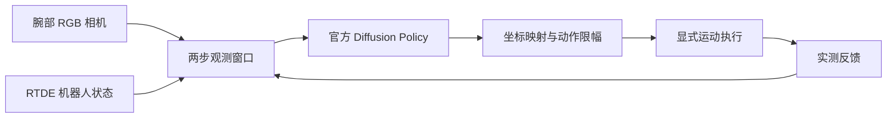

# Diffusion Policy on UR7e

[English](README.md) | [简体中文](README.CN.md)

本项目基于源码部署，将 UR7e 机械臂和单个腕部 Orbbec Gemini 335L RGB 相机接入官方 Diffusion Policy。提供真实观测采集、checkpoint 校验与加载、坐标适配、受限运动执行和反馈记录。

当前基线使用公开的**仿真 Push-T 图像 Transformer 权重**，将二维动作映射到 UR 基坐标系 X/Y，并固定高度与姿态。现阶段目标是建立可复现的“硬件输入—策略推理—机械臂运动”链路；真实 Push-T 任务表现及腕部视角适配仍待评估。

## 系统概览



项目新增的硬件与执行适配代码位于 `src/dp_ur7e/`。网络构建、训练参数、归一化和扩散采样复用固定版本的上游实现及 checkpoint。通过独立运行模式，可以在运动前分别检查采集、推理和数值预览。

## 当前支持的基线

| 组件 | 当前配置 |
|---|---|
| 运行主机 | Linux；平台为 Ubuntu 22.04、ROS 2 Humble、NVIDIA GPU |
| 机械臂 / 相机 | UR7e / 单路 Gemini 335L 腕部 RGB 图像 |
| 策略 | `DiffusionTransformerHybridImagePolicy`，官方仿真 Push-T 权重 |
| 观测 | 两张 `96 x 96` RGB 图像及两次对应的二维位置 |
| 预测 | 10 个位置的预测窗口，返回 8 个位置；执行使用 `action[0,0]` |
| 采样器 | 原始 100 步 DDPM、官方 EMA 参数与内置归一化器 |
| 控制 | 项目专用 ur_rtde 1.6.5 扩展，受限异步 `moveL` |

执行最多考虑三个目标，单步不超过 1 mm，累计指令路径不超过 3 mm，距初始位置的半径不超过 3 mm，速度为 2 mm/s，加速度为 5 mm/s²，不发送夹爪命令。这些属于工程约束，不是碰撞规划或安全认证。

## 快速开始：准备与检查

以下命令用于 **Linux 运行主机**。从包含 `pyproject.toml` 和 `src/` 的仓库根目录开始，事先确保 conda 可用。完整前置条件、终端隔离和设备设置见[部署指南](docs/guide.CN.md)。

切换目录不会自动切换 Python 环境。下面显式指定的解释器选择本项目的 `.envs/inference`；直接输入 `python`，可能使用系统 Python 或其他环境。

```bash
cd /absolute/path/to/diffusion_policy_ur7e
bash scripts/prepare_environment.sh
./.envs/inference/bin/python scripts/fetch_checkpoint.py
cp -n config.example.yaml config.yaml
./.envs/inference/bin/python -m dp_ur7e inspect --config ./config.yaml
```

`cp -n` 保留已有本地配置。`inspect` 检查文件与模型接口，不构建策略、不连接设备。模板中的 `192.0.2.1` 仅允许用于检查，其他模式都会拒绝该地址；使用真实输入前应填写实际地址。检查成功不等于依赖、相机或机器人已经通过验收。

真实输入按指南中的**外部驱动 → ROS 桥接 → capture → shadow → preview**顺序验证。运动执行是单独显式选择的阶段。准备环境不会启动这些进程。

## 运行模式

| 模式 | 用途 | 机器人通信 | 运动客户端 |
|---|---|---|---|
| `inspect` | 检查本地配置和模型文件 | 无 | 否 |
| `camera-bridge` | 接收已有 ROS 话题，更新本地图像交换文件 | 无 | 否 |
| `capture` | 保存一个有效观测窗口 | RTDE Receive | 否 |
| `shadow` | 保存真实观测对应的预测 | RTDE Receive | 否 |
| `preview` | 计算受限目标，不发令 | RTDE Receive 与只读 Dashboard | 否 |
| `execute` | 发送受限目标并确认完成 | Receive、Dashboard、受保护 Control | 是 |

`execute` 同时要求 `--site-ready` 和激活 TCP 配置确认。它使用新观测，丢弃预热预测，并在测量确认完成后重新规划。前置条件和限制见[执行操作说明](docs/guide.CN.md)。

## 仓库结构

```text
src/dp_ur7e/
  cli.py, config.py, pipeline.py   # 入口、配置与流程协调
  hardware/                       # 相机桥接、状态与观测历史
  inference/                      # 上游策略加载和预测
  control/                        # 数值约束、控制库与反馈
  geometry.py, recording.py       # 坐标与运行记录
config.example.yaml               # 位于仓库根目录的本地配置模板
models/                           # 权重、来源记录、可读模型配置
third_party/                      # 固定上游策略与修改后的 SDK 源码
scripts/                          # 环境、模型、后端、传输和校验工具
tests/                            # 离线测试与本机通信测试
docs/                             # 指南、技术报告和验证数据
```

本机环境、缓存、图像交换文件、编译控制库和原始运行记录按需生成，并由 Git 忽略。源码安装可能生成 `*.egg-info`；日常开发无需制作分发 wheel 或执行发布构建。

## 文档与代码阅读路径

| 文档 | 用途 |
|---|---|
| [部署指南](docs/guide.CN.md) | 明确解释器、配置、手动启动、预期输出、故障排查和开发流程 |
| [技术报告](docs/technical_report.CN.md) | 接口定义、坐标关系、过滤与控制设计、证据和局限 |
| [验证数据](docs/validation.json) | 机器可读的历史测量与已记录离线检查 |

阅读实现时，先看 `cli.py` → `pipeline.py`，再依次看观测构建、策略封装、坐标映射、动作过滤和机器人执行器。指南将各阶段对应到函数与文件。应用改动集中在适配层；更新第三方代码时，应同步维护来源锁定、补丁记录并进行核查。

## 来源与引用

官方策略固定为 [real-stanford/diffusion_policy](https://github.com/real-stanford/diffusion_policy) 的提交 `5ba07ac6661db573af695b419a7947ecb704690f`。Checkpoint 身份记录在 `models/checkpoint_manifest.json`；第三方源码身份与控制补丁记录在 `third_party/`。

学习策略方法应引用 [Diffusion Policy 项目与论文](https://diffusion-policy.cs.columbia.edu/)。
