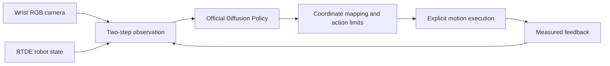

# Diffusion Policy on UR7e

[English](README.md) | [简体中文](README.CN.md)

A source-based deployment project connecting a UR7e manipulator and one wrist-mounted Orbbec Gemini 335L RGB camera to the official Diffusion Policy implementation. It provides real observation acquisition, verified checkpoint loading, coordinate adaptation, bounded motion execution, and feedback records.

The current baseline uses the public **simulated Push-T image Transformer checkpoint**. Its two-dimensional actions are mapped to UR-base X/Y while height and orientation remain fixed. The current milestone is a reproducible hardware-to-policy-to-motion pipeline; real-world Push-T performance and wrist-view adaptation remain to be evaluated.

## System overview



The project owns the hardware and execution adapters in `src/dp_ur7e/`. Network construction, learned parameters, normalization, and diffusion sampling are reused from the pinned upstream implementation and checkpoint. Operating modes also allow acquisition, inference, and numerical preview to be checked separately before motion.

## Supported baseline

| Component | Current configuration |
|---|---|
| Runtime host | Linux; platform: Ubuntu 22.04, ROS 2 Humble, NVIDIA GPU |
| Robot / camera | UR7e / one Gemini 335L wrist RGB stream |
| Policy | `DiffusionTransformerHybridImagePolicy`, official simulated Push-T weights |
| Observation | Two RGB images at `96 x 96` and two corresponding planar positions |
| Prediction | 10-position horizon; 8-position returned segment; execution uses `action[0,0]` |
| Sampler | Original 100-step DDPM, official EMA parameters and embedded normalizer |
| Control | Project-private ur_rtde 1.6.5 extension; bounded asynchronous `moveL` |

Execution uses at most three targets, a 1 mm single-step limit, a 3 mm cumulative-path limit, a 3 mm initial-position radius, 2 mm/s speed, and 5 mm/s² acceleration. No gripper command is issued. These are engineering limits, not collision planning or a safety certification.

## Quick start: prepare and inspect

These commands target the **Linux runtime host**. Start in the repository root, containing `pyproject.toml` and `src/`. Conda must already be available. See the [guide](docs/guide.md) for prerequisites, terminal isolation, and device setup.

**Changing directory does not select a Python environment.** The explicit interpreter below selects this project's `.envs/inference`; a bare `python` may refer to system Python or another environment.

```bash
cd /absolute/path/to/diffusion_policy_ur7e
bash scripts/prepare_environment.sh
./.envs/inference/bin/python scripts/fetch_checkpoint.py
cp -n config.example.yaml config.yaml
./.envs/inference/bin/python -m dp_ur7e inspect --config ./config.yaml
```

`cp -n` preserves an existing local configuration. `inspect` checks files and the model interface without constructing the policy or connecting devices. The template's `192.0.2.1` address is accepted for inspection and rejected by all other modes; configure the real address before using live inputs. A successful inspection is not a dependency, camera, or robot acceptance test.

For real inputs, continue with the guide's **external driver → ROS bridge → capture → shadow → preview** sequence. Motion is a separate, explicitly selected stage. Preparing the environment does not start any of these processes.

## Operating modes

| Mode | Purpose | Robot communication | Motion client |
|---|---|---|---|
| `inspect` | Check local configuration and model files | None | No |
| `camera-bridge` | Receive an existing ROS topic and write the local frame store | None | No |
| `capture` | Save one valid observation window | RTDE Receive | No |
| `shadow` | Save predictions from real observations | RTDE Receive | No |
| `preview` | Compute constrained targets without dispatch | RTDE Receive and read-only Dashboard | No |
| `execute` | Dispatch bounded targets and verify completion | Receive, Dashboard, guarded Control | Yes |

`execute` requires both `--site-ready` and confirmed active-TCP configuration. It uses fresh observations, discards the warm-up prediction, and waits for measured completion before replanning. Follow the [execution procedure](docs/guide.md) for its prerequisites and limits.

## Repository map

```text
src/dp_ur7e/
  cli.py, config.py, pipeline.py   # entry, configuration, orchestration
  hardware/                       # camera bridge, state, observation history
  inference/                      # upstream policy loading and prediction
  control/                        # numerical guards, backend and feedback
  geometry.py, recording.py       # coordinates and run artifacts
config.example.yaml               # local settings template at repository root
models/                           # checkpoint, provenance, readable model config
third_party/                      # pinned policy and guarded SDK source
scripts/                          # environment, model, backend, transfer, verification
tests/                            # offline and native transport checks
docs/                             # guide, technical report, validation data
```

Machine-specific environments, caches, frame exchange, compiled backends, and raw run records are generated locally and excluded from Git. Source installation may generate `*.egg-info`; ordinary development does not require a distributable wheel or a release build.

## Documentation and code-reading path

| Read | Use it for |
|---|---|
| [Deployment guide](docs/guide.md) | Exact interpreters, configuration, manual startup, expected outputs, troubleshooting, and development workflow |
| [Technical report](docs/technical_report.md) | Interface definitions, geometry, filtering, control design, evidence, and limitations |
| [Validation data](docs/validation.json) | Machine-readable historical measurements and recorded offline checks |

To follow the implementation, read `cli.py` → `pipeline.py`, then the observation builder, policy wrapper, coordinate map, action guard, and robot executor. The guide maps each stage to its functions and files. Keep application changes in the adapter; vendor updates require corresponding source locks, patch records, and review.

## Provenance and attribution

The official policy is pinned to commit `5ba07ac6661db573af695b419a7947ecb704690f` of [real-stanford/diffusion_policy](https://github.com/real-stanford/diffusion_policy). Checkpoint identity is recorded in `models/checkpoint_manifest.json`; vendor identities and the control patch are recorded under `third_party/`.

Cite the [Diffusion Policy project and publication](https://diffusion-policy.cs.columbia.edu/) for the learned method. Preserve upstream licenses and notices. 
