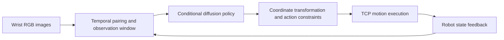

# Deployment and Preliminary Hardware Validation of Diffusion Policy on the UR7e Platform

## 1. System Configuration and Deployment Objective

Diffusion Policy [1] is integrated with the existing UR7e manipulation platform to connect visual observations, conditional action generation, and TCP motion execution. The platform comprises a six-degree-of-freedom UR7e, a CB5 v5.5 controller, a Robotiq 2F-85 end-effector assembly, and an Orbbec Gemini 335L wrist camera. The controller runs PolyScope 5.23.0. An external workstation performs image processing, policy inference, and robot communication.

This stage uses the authors' public simulated Push-T image Transformer weights without additional training. Observations consist of a single wrist RGB stream and planar TCP positions. Model outputs are converted into local position targets in the robot base frame. TCP height and orientation remain fixed, and no gripper commands are sent. The validation objective is to establish that real observations can drive policy inference and produce measurable TCP displacement through a constrained control interface.

The camera supplies images through ROS 2, while robot state is acquired through Real-Time Data Exchange (RTDE). Predicted actions undergo coordinate conversion and displacement filtering before execution through `ur_rtde`. Internal servo control remains with the robot controller; the external policy updates targets using observations and motion feedback. Figure 1 illustrates the functional relationships.

*Figure 1. Closed-loop relationship between wrist observations, diffusion-policy inference, and TCP execution.*

| Item | Experimental setting |
|---|---|
| Input camera | One Gemini 335L, RGB data only |
| RGB acquisition setting | 640×480, configured at 30 fps |
| Policy image input | One 96×96 RGB image per observation time |
| Observation window | Two temporal samples, target spacing 0.1 s |
| Requested RTDE reception rate | 125 Hz |
| Tool TCP offset | $(0,0,244)$ mm in the flange frame, zero rotation |
| Motion domain | Local displacement in base-frame X/Y |

*Table 1. Platform interfaces and observation-acquisition settings.*

## 2. Observation Acquisition and Coordinate Representation

### 2.1 Image Processing and Temporal Pairing

Wrist RGB images undergo encoding and timestamp checks, followed by a centre-square or specified region-of-interest crop and resizing to 96×96. Pixels are converted to float32 and divided by 255, yielding $[0,1]$ image inputs. The visual encoder retains the pretrained policy's 84×84 fixed evaluation crop, applied after image preprocessing.

Robot state includes TCP pose, six joint positions, controller time, and operating and safety modes. Controller timestamps are checked before and after state acquisition. A changed timestamp triggers another read; five consecutive inconsistent attempts terminate acquisition. The policy uses only the planar state derived from TCP position; joint positions and operating modes support execution monitoring.

Images and robot states are paired using the workstation's monotonic clock. Relative to the latest image-reception time, the most recent image no later than each of two target times 0.1 s apart is selected. Selection error is limited to 0.05 s. Each image is then associated with the most recent robot state preceding its reception, also with a maximum pairing difference of 0.05 s.

The two observations must use distinct image frames. Image and state ages at window construction are limited to 0.5 s, with image age including message delay before the processing callback. This provides host-side causal pairing without hardware-trigger synchronization between camera and robot controller.

### 2.2 TCP Geometry

Following the platform's pose convention, TCP pose and joint configuration are

$$
\begin{aligned}
\mathbf p_t &= [x_t,y_t,z_t,r_{x,t},r_{y,t},r_{z,t}]^\top,\\
\mathbf q_t &= [q_{1,t},q_{2,t},\ldots,q_{6,t}]^\top.
\end{aligned}
$$

Translation is measured in metres. Orientation uses an axis-angle rotation vector; joint angles and rotation-vector components are measured in radians. The TCP position alone is denoted by $\mathbf x_t=[x_t,y_t,z_t]^\top$.

Let $B$, $F$, $C$, and $R$ denote the robot base, tool flange, active controller TCP, and platform reference TCP. $T_{AB}$ is the homogeneous pose of frame $B$ in frame $A$. Then

$$
T_{BR}=T_{BC}(T_{FC})^{-1}T_{FR}.
$$

The controller's actual TCP pose corresponds to $T_{BC}$ and already includes the active tool offset. In this experiment, $T_{FC}=T_{FR}$: both tool transformations translate 244 mm along flange Z with zero rotation. Reference and active TCP positions therefore coincide. This convention avoids applying tool length twice to a measured position.

### 2.3 Planar Action Coordinates

The public Push-T policy uses virtual planar positions. A session-relative map connects model and robot spaces, with the first measured reference TCP position $\mathbf x_0$ as origin:

$$
\begin{aligned}
\mathbf u_t
&=\mathbf u_0+\operatorname{diag}(\mathbf s)\mathbf E(\mathbf x_t-\mathbf x_0),\\
\mathbf x_t^{\mathrm{ref}}
&=\mathbf x_0+\mathbf E^\top\operatorname{diag}(\mathbf s)^{-1}
(\mathbf a_t^{\mathrm{ref}}-\mathbf u_0).
\end{aligned}
$$

Here $\mathbf u_t$ is the planar policy observation, $\mathbf a_t^{\mathrm{ref}}$ is the selected model reference action, and $\mathbf E\in\mathbb R^{2\times3}$ selects base-frame X/Y. The experiment uses $\mathbf u_0=(256,256)^\top$ and $\mathbf s=(1000,1000)^\top$ virtual pixels/metre.

The mapping projects measured positions into the model's planar action space and converts model references back to metric targets. Model coordinates range over $[0,512]$, independently of 96×96 image indices. This scale-and-translation relationship provides an engineering interface; it does not establish geometric calibration between wrist-image pixels and the workspace plane.

## 3. Conditional Diffusion-Policy Inference

Each inference uses two image–position pairs:

$$
\mathcal O_t=
\left\{(\mathbf I_t^{(i)},\mathbf u_t^{(i)})\right\}_{i=1}^{T_o},
\qquad T_o=2.
$$

The visual encoder comprises ResNet-18, Spatial Softmax, and Group Normalization; a Transformer predicts action noise. The model retains the public weights' exponential-moving-average parameters and training-data normalization state. Network parameters remain fixed during inference.

Conditional generation begins with a standard Gaussian sample in normalized action space. Observation encoding remains fixed during 100 DDPM denoising steps [2]. Sampling retains the selected model's squared-cosine noise schedule, noise-prediction parameterization, and fixed-small variance. The resulting actions are converted back to their original virtual-coordinate units using the embedded model transformation.

Table 2 lists input and output dimensions. Batch size is fixed at 1, with channel-first image ordering.

| Data | Tensor shape | Meaning |
|---|---|---|
| Temporal images | $1\times2\times3\times96\times96$ | Single-view RGB images at two times |
| Low-dimensional observations | $1\times2\times2$ | Two corresponding virtual planar positions |
| Full action prediction | $1\times10\times2$ | Ten planar reference positions |
| Returned action segment | $1\times8\times2$ | Eight references aligned with the observation window |

*Table 2. Input and output dimensions of the selected policy; the first dimension is the batch dimension.*

Let the full prediction be $\mathbf A_t=(\mathbf a_{t,0},\ldots,\mathbf a_{t,9})$. The returned segment begins at full-window index $T_o-1=1$, so the execution reference is

$$
\mathbf a_t^{\mathrm{ref}}=\mathbf a_{t,1}.
$$

Only this first reference is selected per iteration. After feedback-confirmed arrival, new observations are used for the next prediction. Each diffusion process is independently initialized; cross-iteration command continuity is handled by displacement smoothing in the execution layer. The eight returned references are not executed directly as an open-loop path.

## 4. Action Execution

### 4.1 Target Generation and Displacement Constraints

After model warmup, a stationary pose $\mathbf p_{\mathrm{init}}$ is acquired to define height, orientation, and local-motion locks. This control baseline is measured and recorded separately from the coordinate-map origin $\mathbf x_0$.

Let $\mathbf x_t$ be the measured position and $\mathbf x_t^{\mathrm{ref}}$ the inverse-mapped reference. Planar displacement is clipped, smoothed, and constrained by the remaining commanded-path budget:

$$
\begin{aligned}
\mathbf b_t
&=\operatorname{clip}_{\ell}
(\mathbf x_{t,xy}^{\mathrm{ref}}-\mathbf x_{t,xy}),\\
\mathbf d_t
&=\operatorname{clip}_{\min(\ell,L-P_t)}
\left[\lambda\mathbf b_t+(1-\lambda)\mathbf d_{t-1}\right].
\end{aligned}
$$

$\operatorname{clip}_r$ limits Euclidean norm to $r$. $\ell$ is the step limit, $L$ the cumulative commanded-path limit, and $P_t$ the committed path. The smoothing gain is $\lambda=0.5$, with zero initial state. $\mathbf d_{t-1}$ is the planar displacement of the previous committed target relative to its pre-dispatch measurement; unsent candidates do not update this state. Target XY equals measured XY plus $\mathbf d_t$. Target Z and rotation vector retain their stationary-baseline values.

The pose is measured again before dispatch to validate the final target and calculate step length and cumulative path. Candidates below 0.01 mm hold position. A session evaluates at most three candidates; candidate count and completed-motion count are recorded separately. Table 3 summarizes the constraints.

| Parameter | Experimental setting |
|---|---:|
| Step displacement limit $\ell$ | 1 mm |
| Cumulative commanded-path limit $L$ | 3 mm |
| Radius from the initial position | 3 mm |
| Commanded TCP speed | 2 mm/s |
| Commanded TCP acceleration | 5 mm/s² |
| Smoothing gain $\lambda$ | 0.5 |
| Maximum oldest effective input age at dispatch | 1.5 s |
| Per-target completion timeout | 3 s |

*Table 3. Command and freshness constraints for local-displacement validation.*

### 4.2 Communication Constraints and Feedback Confirmation

Motion uses the asynchronous absolute-pose `moveL` interface of `ur_rtde` [3]. State reception and motion control use separate interfaces. The first model prediction is discarded as warmup. The motion-control connection is established after warmup, stationary-baseline acquisition, and controller-state checks.

Each dispatch verifies the active TCP, operating and safety modes, target pose and joint safety limits, and inverse kinematics. Per-joint target change is limited to 0.01 rad, with a maximum departure of 1° from the initial joint position. Controller readiness must persist for 20 ms within a 300 ms wait.

To constrain the effect of communication faults on target freshness, failure handling is adjusted from `ur_rtde` 1.6.5. Automatic reconnect and command replay are disabled; linear-motion commands require immediate dispatch readiness. Runtime command and send waits are limited to 1 s and 0.5 s, respectively, and stop failures are reported explicitly. These changes constrain runtime communication behavior without establishing a system-wide hard real-time guarantee.

Effective input age is the age of the oldest image or paired state in the observation window, including pre-callback image delay. Freshness is checked again after controller queries and after dispatch-intent recording. Targets exceeding 1.5 s are rejected.

During motion, feedback timing, controller state, pose, joints, speed, and force/torque are checked approximately every 20 ms. Completion requires a changed asynchronous finished state, TCP speed below the stationary threshold, and three consecutive position checks within

$$
\varepsilon_x=
\min\left(50\,\mu\mathrm m,\;0.4\,d^{\mathrm{cmd}}\right),
$$

where $d^{\mathrm{cmd}}$ is the final commanded displacement. Command acknowledgement indicates interface acceptance; measured arrival is evaluated separately using these criteria. Exceptions enter stop and cleanup handling. Failed targets are not automatically resent, and test termination does not return the robot to its initial pose.

## 5. Hardware Validation

### 5.1 Protocol and Metrics

An end-to-end deployment test was conducted on 2026-10-25, with records corresponding to the implementation used on that date. Each iteration used actual wrist images and RTDE state for observation construction, policy inference, action mapping, displacement filtering, and feedback-confirmed execution. The session recorded three completed targets and 132 feedback samples.

For target $i$, let the pre-dispatch, commanded, and settled TCP positions be $\mathbf x_i^{\mathrm{before}}$, $\mathbf x_i^{\mathrm{target}}$, and $\mathbf x_i^{\mathrm{after}}$. Evaluation metrics are

$$
\begin{aligned}
d_i^{\mathrm{cmd}}
&=\|\mathbf x_i^{\mathrm{target}}-\mathbf x_i^{\mathrm{before}}\|_2,\\
d_i^{\mathrm{obs}}
&=\|\mathbf x_i^{\mathrm{after}}-\mathbf x_i^{\mathrm{before}}\|_2,\\
e_i
&=\|\mathbf x_i^{\mathrm{after}}-\mathbf x_i^{\mathrm{target}}\|_2.
\end{aligned}
$$

These denote commanded displacement, measured start-to-end displacement, and final position error. Inference time covers the policy call and output transfer to CPU, excluding the complete acquisition, dispatch, and arrival-wait cycle.

### 5.2 Results

| Metric | Target 1 | Target 2 | Target 3 |
|---|---:|---:|---:|
| Commanded displacement (mm) | 0.500405 | 0.773970 | 0.844640 |
| Measured displacement (mm) | 0.494955 | 0.751001 | 0.831420 |
| Position error (mm) | 0.013850 | 0.025017 | 0.017835 |
| Inference time (s) | 0.602357 | 0.600784 | 0.602541 |
| Input age at dispatch (s) | 1.017711 | 0.858719 | 0.891487 |

*Table 4. Controller-feedback measurements for three targets in one deployment test.*

Cumulative commanded path was 2.119015 mm and net measured displacement was 2.022260 mm. Cumulative path sums individual command lengths; net displacement measures session start-to-end distance. All targets obtained motion-completion feedback, establishing connectivity between real observations, policy output, and bounded TCP execution in this test.

Initial inference took approximately 2.1 s, followed by three recorded predictions of approximately 0.60 s. The 125 Hz RTDE reception request describes state communication and is distinct from target-update and internal servo frequencies. Position metrics are computed from controller feedback; no external metrology system was used to verify absolute positioning accuracy.

## 6. Discussion and Validation Limits

This test evaluates system integration and local-motion execution. It does not evaluate Push-T object pose, target overlap, or task success. Three motion targets within one session are not three independent task episodes and are insufficient to estimate system repeatability or policy generalization.

The public weights were trained in simulated Push-T, while current images come from a physical wrist camera. Planar mapping reconciles dimensions and units without ensuring that image content and action coordinates match the training distribution. Existing results therefore support the operability of the real-input-to-bounded-execution chain, without establishing wrist-view transfer or physical Push-T performance.

Local-displacement constraints and feedback monitoring do not include full-scene collision planning. Further evaluation requires independent repeated tests following system changes, TCP/workspace and visual calibration, and training and testing protocols based on real demonstrations and explicit task metrics.

## References

[1] Chi, C., et al. *Diffusion Policy: Visuomotor Policy Learning via Action Diffusion*. The International Journal of Robotics Research, 2024 (online publication). [Paper](https://diffusion-policy.cs.columbia.edu/diffusion_policy_ijrr.pdf).

[2] Ho, J., Jain, A., and Abbeel, P. *Denoising Diffusion Probabilistic Models*. arXiv:2006.11239, 2020. [Paper](https://arxiv.org/abs/2006.11239).

[3] SDU Robotics. *ur_rtde Documentation: API Reference*. [Official documentation](https://sdurobotics.gitlab.io/ur_rtde/pages/reference/api.html).
